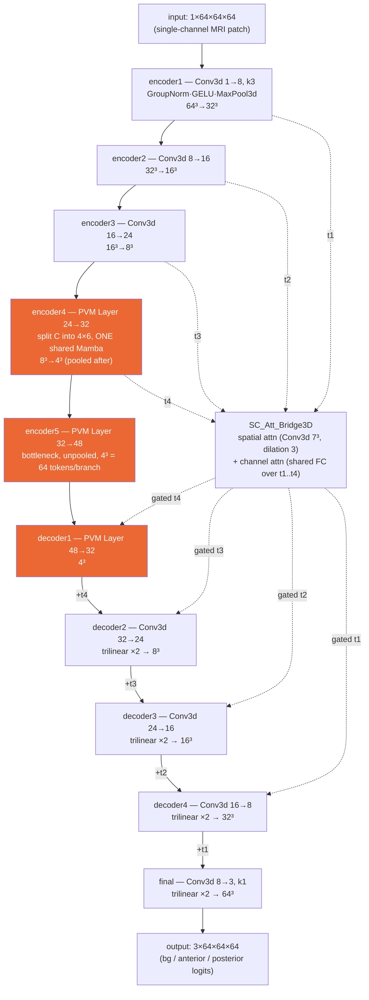

# PVM-3D: extending UltraLight VM-UNet to volumetric segmentation

Status: **architecture designed and prototyped, not yet trained.** Everything below the
"Measured" table is real (a working model, measured on this machine); everything under
"Performance estimate" is a grounded prediction, not a result — no training run has
happened yet. See `docs/3d_pvm_prototype/` for the runnable prototype this doc describes.

## Why this is a real gap, not a rehash

Checked against the closest published work before starting (full write-up: ask about
"3D PVM prior art" in this conversation's history, or see the search below):

- **SegMamba / SegMamba-V2 / BiSegMamba** parallelize 3D Mamba by *scan direction*
  (tri-oriented: x/y/z axes) — a different axis of parallelization than PVM's channel split.
- **LightM-UNet** already does lightweight Mamba in 3D (1M params) but with a single
  scan + residual per layer, not PVM's 4-way split with one *shared* Mamba.
- **MobileViM** is the closest in spirit (lightweight, dimension-independent for 3D) but
  uses a different mechanism ("Dimin": per-spatial-dimension processing + dual-direction
  traversal).
- **CS-MUNet** treats the channel axis itself as the SSM sequence — different from PVM's
  "split channels into 4 groups, scan each group's *spatial* tokens through one shared
  Mamba" — and is 2D-only (52.2M params; not lightweight), with 3D listed as future work.
- A systematic Pattern Recognition 2026 benchmark of 3D Mamba adaptations (3D depthwise
  conv, multi-scale fusion, tri-scan, dual-scan) tests none of these and doesn't cite
  UltraLight VM-UNet or PVM.

No paper does PVM's specific shared-weight 4-way channel split in 3D. The defensible
framing is *"does PVM's specific parallelization choice transfer to 3D, and how does its
params/FLOPs/DSC trade-off compare to the tri-scan and dimension-independent
alternatives already published"* — not "first 3D Mamba" (that's SegMamba, 2024) or
"first lightweight one" (LightM-UNet / MobileViM).

## Architecture

Orange = PVM layers (untouched Mamba mechanism — `PVMLayer.forward` flattens
`x.shape[2:]` generically, so the 4-way split + shared Mamba works on a 3D token
sequence exactly as on a 2D one, no code change).

## What actually differs from the 2D model — and why

| | 2D (this repo, `models/UltraLight_VM_UNet.py`) | 3D prototype |
|---|---|---|
| `Conv2d` / `Conv1d` spatial ops | `Conv2d`, `max_pool2d`, `interpolate(bilinear)`, `AdaptiveAvgPool2d` | swapped 1:1 for `Conv3d`, `max_pool3d`, `interpolate(trilinear)`, `AdaptiveAvgPool3d` |
| `GroupNorm`, `PVMLayer` (the Mamba mechanism itself) | unchanged | **unchanged** — no 3D-specific code needed here at all |
| downsampling depth | 5 stages (256³→8, well actually 256²→8²: a /32 reduction) | **4 stages** (64³→4³, also /16) |
| `c_list` length | 6 entries, 3 plain-conv + 3 PVM | 5 entries, 3 plain-conv + **2 PVM** |
| output head | `num_classes=1`, sigmoid, binary | `num_classes=3`, raw logits (softmax/CE outside) — Hippocampus is bg/anterior/posterior |

The depth change is the one real design decision, not a mechanical port. Applying the
2D model's 5-stage schedule to a 64³ patch would bottleneck at 2³ = 8 voxels — too
coarse to be useful for a structure this small. Hippocampus volumes are tiny natively
(~35–50 voxels/side raw before resampling), so 4 stages (bottleneck at 4³ = 64 voxels)
is a better match to the actual anatomy than reproducing the 2D depth verbatim would be.

## Measured (real numbers, this machine, RTX 5060 Laptop GPU)

`docs/3d_pvm_prototype/model3d.py` + `baseline_unet3d.py`, both forward+backward on a
`1×1×64×64×64` input, `thop` for FLOPs (same tool, same blind spot as the 2D model's
documented GFLOPs note — thop can't see inside `mamba_inner_fn`, so PVM-3D's true FLOPs
are somewhat higher than the number below, exactly as documented for the 2D model).

| | PVM-3D (proposed) | Standard 3D U-Net† | ratio |
|---|---|---|---|
| parameters | **64,804** (0.065M) | 5,644,947 (5.645M) | **87x fewer** |
| GFLOPs (thop) | **0.262** | 16.736 | **64x fewer** |
| train step (bs=1) | **14.4 ms** | 30.6 ms | **2.1x faster** |
| peak VRAM (bs=1) | **0.135 GB** | 0.441 GB | **3.3x less** |

† 16-32-64-128-256 channel double-conv U-Net, 4 downsampling stages (matched in depth
to PVM-3D for a fair comparison) — the width range MONAI/nnU-Net-style pipelines
actually use for this task, not the original Çiçek et al. paper's 19M-param sizing that
nobody runs for a structure this small.

Both models ran a real forward+backward pass without error (gradient flow confirmed,
not just an architecture that instantiates).

## Performance estimate — a prediction, not a result

No training has happened. The estimate below is built from two anchors, both real:

**Anchor 1 — the 2D precedent, already in this repo's own reference paper.** On
ISIC2017, plain U-Net (2.009M params) scored DSC 0.8989; UltraLight VM-UNet (0.049M
params, 41x fewer) scored **0.9091 — higher, not lower**, despite the massive
compression. The paper's own explanation: PVM's parallel branches concentrate on the
target region, which helps DSC/IoU at a small cost to background (SP) recognition.

**Anchor 2 — published Hippocampus baselines.** nnU-Net (a heavily-engineered,
self-configuring pipeline — deep supervision, ensembling, extensive augmentation) gets
~0.89–0.90 DSC on this task. A plain, non-self-configuring 3D U-Net like the one
measured above would realistically land somewhat below that, roughly **0.85–0.88 DSC**.

**Prediction: PVM-3D likely lands in the 0.80–0.87 DSC range** — plausibly close to or
even matching the standard-U-Net baseline, but with meaningfully more downside risk than
the 2D case, for reasons specific to this project's own findings, not generic caution:

- The compression ratio here (87x) is roughly *double* the 2D case's (41x), on a
  3-class task instead of binary.
- This project's own failure analysis (`results/COMPARISON.md#failure-analysis-and-augmentation`)
  found PVM-based models have a **measured, size-linked over-segmentation bias**: small
  lesions get rounded into a bigger, smoother blob (59% of ISIC2018's outliers,
  correlation −0.53 between lesion size and over-segmentation severity). Hippocampus is
  *entirely* small-ROI — there's no large-diffuse-structure case to balance it out the
  way ISIC2018 had both failure modes. This is the single most likely place the 3D model
  underperforms a plain 3D U-Net: boundary precision on a small, thin structure.
- 4 downsampling stages was chosen to preserve resolution for this small ROI; if that
  turns out to be too shallow for the model to build enough context, that would show up
  as a real, measurable DSC gap versus the deeper standard baseline — another concrete,
  checkable risk rather than a vague one.

The only way to replace this range with a real number is to train it — that's the
natural next step if this direction is pursued.

## Next steps (not started)

1. Data pipeline: MSD Task04_Hippocampus (263 training volumes, AWS Open Data / Hugging
   Face — no PH2-style manual request-form friction), patch extraction to 64³, split
   train/val/test matching this repo's seeded-permutation convention
   (`dataprepare/Prepare_ISIC2017.py`'s documented split-bias lesson applies here too).
2. Train PVM-3D and the standard-3D-U-Net baseline under identical conditions (same
   split, seed, optimizer, schedule) — mirroring how every 2D result in this repo has a
   like-for-like baseline.
3. Given the size-linked over-segmentation risk above, look at per-case DSC broken down
   by hippocampus volume size specifically, not just an aggregate — the same diagnostic
   this repo already built for ISIC2018 (`scripts/failure_analysis.py`) generalizes
   directly.
