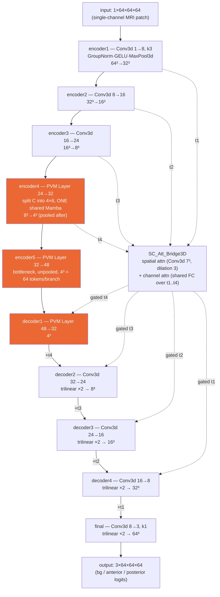

# PVM-3D: extending UltraLight VM-UNet to volumetric segmentation

> **Journal version:** the experiment and dataset plan for the publication, and the nnU-Net-based
> infrastructure that supersedes this document's pipeline, are in
> [3d_journal_roadmap.md](3d_journal_roadmap.md). The results below are the preliminary ones it builds on.

Status: **trained and evaluated on real data.** Both PVM-3D and the standard 3D U-Net
baseline were trained for 300 epochs on MSD Task04_Hippocampus (200 train / 30 val / 30
test volumes) under identical conditions (same split, seed, optimizer, schedule) and
evaluated on the held-out test set. The former "Performance estimate" section below has
been replaced with these measured results. The production code lives at
`models/UltraLight_VM_UNet_3D.py`, `models/StandardUNet3D.py`, `train3d.py`,
`dataprepare/Prepare_Hippocampus.py`, and `scripts/failure_analysis_3d.py` — promoted
from the `docs/3d_pvm_prototype/` prototype this doc originally described.

## Why this is a real gap, not a rehash

Checked against the closest published work before starting (full write-up: ask about
"3D PVM prior art" in this conversation's history, or see the search below):

- **SegMamba / SegMamba-V2 / BiSegMamba** parallelize 3D Mamba by *scan direction*
  (tri-oriented: x/y/z axes) — a different axis of parallelization than PVM's channel split.
- **LightM-UNet** already does lightweight Mamba in 3D (1M params) but with a single
  scan + residual per layer, not PVM's 4-way split with one *shared* Mamba.
- **MobileViM** is the closest in spirit (lightweight, dimension-independent for 3D) but
  uses a different mechanism ("Dimin": per-spatial-dimension processing + dual-direction
  traversal).
- **CS-MUNet** treats the channel axis itself as the SSM sequence — different from PVM's
  "split channels into 4 groups, scan each group's *spatial* tokens through one shared
  Mamba" — and is 2D-only (52.2M params; not lightweight), with 3D listed as future work.
- A systematic Pattern Recognition 2026 benchmark of 3D Mamba adaptations (3D depthwise
  conv, multi-scale fusion, tri-scan, dual-scan) tests none of these and doesn't cite
  UltraLight VM-UNet or PVM.

No paper does PVM's specific shared-weight 4-way channel split in 3D. The defensible
framing is *"does PVM's specific parallelization choice transfer to 3D, and how does its
params/FLOPs/DSC trade-off compare to the tri-scan and dimension-independent
alternatives already published"* — not "first 3D Mamba" (that's SegMamba, 2024) or
"first lightweight one" (LightM-UNet / MobileViM).

## Architecture

Orange = PVM layers (untouched Mamba mechanism — `PVMLayer.forward` flattens
`x.shape[2:]` generically, so the 4-way split + shared Mamba works on a 3D token
sequence exactly as on a 2D one, no code change).

## What actually differs from the 2D model — and why

| | 2D (this repo, `models/UltraLight_VM_UNet.py`) | 3D prototype |
|---|---|---|
| `Conv2d` / `Conv1d` spatial ops | `Conv2d`, `max_pool2d`, `interpolate(bilinear)`, `AdaptiveAvgPool2d` | swapped 1:1 for `Conv3d`, `max_pool3d`, `interpolate(trilinear)`, `AdaptiveAvgPool3d` |
| `GroupNorm`, `PVMLayer` (the Mamba mechanism itself) | unchanged | **unchanged** — no 3D-specific code needed here at all |
| downsampling depth | 5 stages (256³→8, well actually 256²→8²: a /32 reduction) | **4 stages** (64³→4³, also /16) |
| `c_list` length | 6 entries, 3 plain-conv + 3 PVM | 5 entries, 3 plain-conv + **2 PVM** |
| output head | `num_classes=1`, sigmoid, binary | `num_classes=3`, raw logits (softmax/CE outside) — Hippocampus is bg/anterior/posterior |

The depth change is the one real design decision, not a mechanical port. Applying the
2D model's 5-stage schedule to a 64³ patch would bottleneck at 2³ = 8 voxels — too
coarse to be useful for a structure this small. Hippocampus volumes are tiny natively
(~35–50 voxels/side raw before resampling), so 4 stages (bottleneck at 4³ = 64 voxels)
is a better match to the actual anatomy than reproducing the 2D depth verbatim would be.

## Measured (real numbers, this machine, RTX 5060 Laptop GPU)

`docs/3d_pvm_prototype/model3d.py` + `baseline_unet3d.py`, both forward+backward on a
`1×1×64×64×64` input, `thop` for FLOPs (same tool, same blind spot as the 2D model's
documented GFLOPs note — thop can't see inside `mamba_inner_fn`, so PVM-3D's true FLOPs
are somewhat higher than the number below, exactly as documented for the 2D model).

| | PVM-3D (proposed) | Standard 3D U-Net† | ratio |
|---|---|---|---|
| parameters | **64,804** (0.065M) | 5,644,947 (5.645M) | **87x fewer** |
| GFLOPs (thop) | **0.262** | 16.736 | **64x fewer** |
| train step (bs=1) | **14.4 ms** | 30.6 ms | **2.1x faster** |
| peak VRAM (bs=1) | **0.135 GB** | 0.441 GB | **3.3x less** |

† 16-32-64-128-256 channel double-conv U-Net, 4 downsampling stages (matched in depth
to PVM-3D for a fair comparison) — the width range MONAI/nnU-Net-style pipelines
actually use for this task, not the original Çiçek et al. paper's 19M-param sizing that
nobody runs for a structure this small.

Both models ran a real forward+backward pass without error (gradient flow confirmed,
not just an architecture that instantiates).

## Measured training results (real, MSD Task04_Hippocampus test set)

Trained with `train3d.py` (`configs/config_setting_3d.py`: AdamW lr 1e-3, wd 1e-2,
CosineAnnealingLR, seed 42, batch 8, 300 epochs — identical across both models) on the
seeded 200 train / 30 val / 30 test split from `dataprepare/Prepare_Hippocampus.py`.

One correction to the estimate this replaces: MSD Task04_Hippocampus ships **260**
labeled training volumes, not 263 — that number was an estimate made before the archive
had actually been opened; `dataset.json`'s `numTraining` and the real file count both
say 260, and the split above (200/30/30) was sized against the real total.

| | PVM-3D | Standard 3D U-Net | 2D precedent (ISIC2017) |
|---|---|---|---|
| parameters | **64,804** (0.065M) | 5,644,947 (5.645M) | 41x fewer, DSC *higher* |
| test DSC, mean over anterior+posterior | **0.8531** | **0.8972** | — |
| test DSC — anterior | 0.8544 | 0.9069 | |
| test DSC — posterior | 0.8518 | 0.8874 | |
| test DSC — background | 0.9984 | 0.9990 | |
| train wall-clock (300 epochs, this GPU) | ~12 min | ~38 min | |

PVM-3D landed at **0.8531** — inside the 0.80–0.87 DSC range this doc predicted before
training, but **4.4 points below** the standard 3D U-Net (0.8972), the opposite
direction from the 2D case (where UltraLight VM-UNet scored *higher* than plain U-Net).
87x fewer parameters for a 4.4-point DSC cost is a real, usable trade-off — not a
failure — but it confirms the risk flagged before training, not the optimistic case.

**The size-linked over-segmentation bias generalizes to 3D, and is worse for PVM-3D
than for the standard U-Net.** `scripts/failure_analysis_3d.py` measured, on the 30 test
volumes:

| | PVM-3D | Standard 3D U-Net |
|---|---|---|
| corr(hippocampus size, area_ratio) | **−0.589** (p=0.001) | −0.412 (p=0.024) |
| over-segmenters (area_ratio > 1.1) | 5 / 30 | 3 / 30 |
| mean area_ratio | 1.034 | 1.007 |

Both models over-segment smaller volumes more than larger ones (negative correlation,
both significant), same direction and similar magnitude to ISIC2018's −0.53 — but the
effect is notably stronger for PVM-3D. This is the same failure mode
`results/COMPARISON.md#failure-analysis-and-augmentation` found in 2D, now confirmed
on an entirely-small-ROI 3D task rather than predicted from it.

## Possible follow-ups

- The gap is concentrated in boundary precision, not gross localization (background DSC
  is within 0.001 of the baseline for both). A targeted fix in the same spirit as the 2D
  repo's augmentation experiment (`scripts/train_augmented.py`) — e.g. elastic
  deformation or boundary-aware loss weighting — is the natural next experiment, the
  same pattern this repo already used once.
- 4 downsampling stages was chosen to preserve resolution for the small ROI; the
  measured gap doesn't rule out that a 5th stage (more global context, at the cost of
  the 2³ bottleneck this doc originally rejected as too coarse) would help — worth a
  direct ablation given the result now exists to compare against.
- Only one seed was run per model. The DSC gap (4.4 points) is well outside the loss
  fluctuation visible late in training (last-50-epoch DSC swings of ~1-1.5 points for
  both models), so it's very unlikely to be noise, but a second seed would confirm it.
